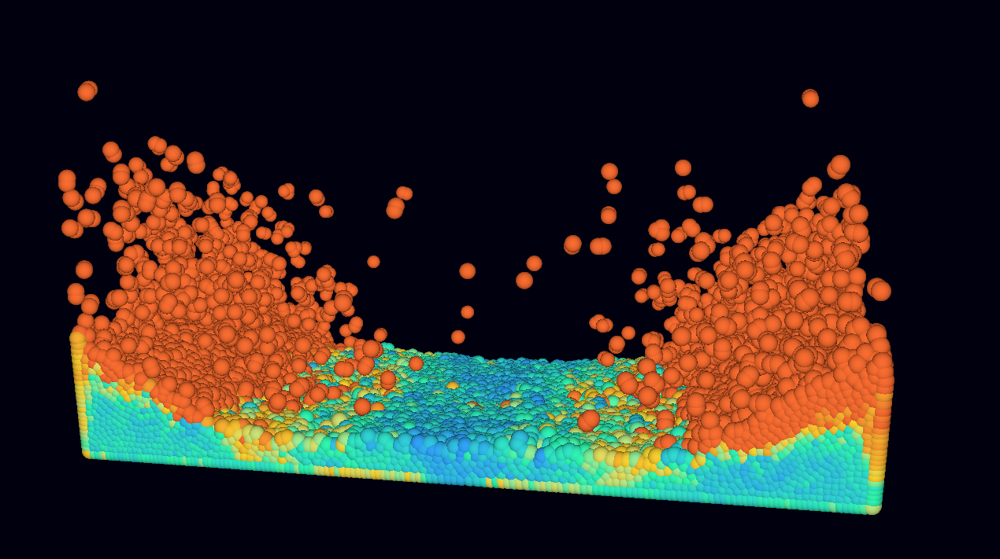
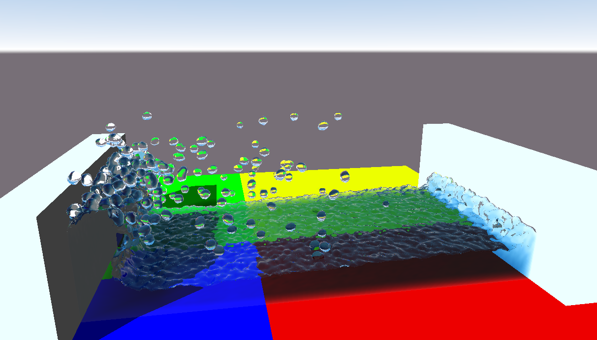

# Vulkan SPH Fluid Simulation

A real-time 3D fluid simulation using **Smoothed Particle Hydrodynamics (SPH)**, written in **C++20** with the particle computation running on the GPU via **Vulkan compute shaders**.





## Features

- Weakly compressible SPH
- GPU neighbor search using spatial hashing so the simulation domain is unbounded and memory use does not depend on the domain size
- Pressure, viscosity and gravity forces computed in compute shaders
- Symplectic Euler integration
- Box objects and box boundary with damped collisions
- Ray marching over fluid density field

## Requirements

| Dependency | Version |
|------------|---------|
| C++ compiler | C++20 |
| Vulkan SDK | 1.4+ |
| GLFW | 3.3+ |
| GLM | 0.9.9+ |

A GPU with Vulkan 1.4 compute support is required.

## How It Works

### SPH in short

A fluid is represented by particles. Any quantity `A` at position `x` is approximated by summing over neighbors within the smoothing radius `h`:

```
A(x) = Σ_j  m_j * (A_j / ρ_j) * W(|x - x_j|, h)
```

**Density**

```
ρ_i = Σ_j m_j * W_poly6(r_ij, h)
```

**Pressure**

```
p_i = k * (ρ_i - ρ_0)
```

**Forces**

```
f_pressure_i  = -Σ_j m_j * (p_i + p_j) / (2 ρ_j) * ∇W_spiky(r_ij, h)
f_viscosity_i =  μ Σ_j m_j * (v_j - v_i) / ρ_j * ∇²W_visc(r_ij, h)
f_gravity_i   =  ρ_i * g
```

**Integration**

```
a_i = f_i / ρ_i
v  += a * dt
x  += v * dt
```

### GPU pipeline (per frame / substep)

```
 external forces -> spatial hash -> reorder -> density -> fluid forces -> integrate -> draw
```
1. **External forces** - apply external forces to particles e.g. gravity.
2. **Spatial hash** – cell size = `h`, so neighbors are found by checking 27 cells (3D).
3. **Density pass** – computes `ρ` and `p` for every particle.
4. **Force pass** – computes acceleration from pressure, viscosity.
5. **Integrate pass** – updates velocity and position, handles box collisions.
6. Compute buffers are shared with the "graphics" pipeline as a vertex/storage buffer, with pipeline barriers between each dispatch.

## Default Parameters

| Parameter | Value | Description |
|-----------|-------|-------------|
| `particlesCount` | 32 768 | number of particles |
| `kernelRadius` | 0.3 | smoothing radius |
| `targetDensity` | 100 | ρ₀ |
| `pressureMultiplier` | 300 | pressure constant `k` |
| `viscosityStrength` | 0.06 | μ |
| `gravity` | (0, -9.81, 0) | m/s² |
| `collisionDamping` | 0.95 | velocity loss on wall hit |

## Controls

| Input | Action |
|-------|--------|
| `Right mouse` + drag | Rotate camera |
| `Scroll` | Zoom |
| `R` | Reset simulation |
| `Space` | Pause / resume |
| `Esc` | Quit |

## Performance

| GPU | Particles | Frame time |
|-----|-----------|------------|
| GTX 1050TI | 32k | _~8 ms_ |
| GTX 1050TI | 65k | _~26 ms_ |

## References

- Müller, Charypar, Gross – *Particle-Based Fluid Simulation for Interactive Applications* (2003)
- Monaghan – *Smoothed Particle Hydrodynamics* (1992)
- Becker, Teschner – *Weakly Compressible SPH for Free Surface Flows* (2007)
- [Vulkan Tutorial](https://vulkan-tutorial.com/) / [Khronos Vulkan Spec](https://registry.khronos.org/vulkan/)
- [Sebastian Lague - Coding Adventure: Rendering Fluids](https://www.youtube.com/watch?v=kOkfC5fLfgE)
